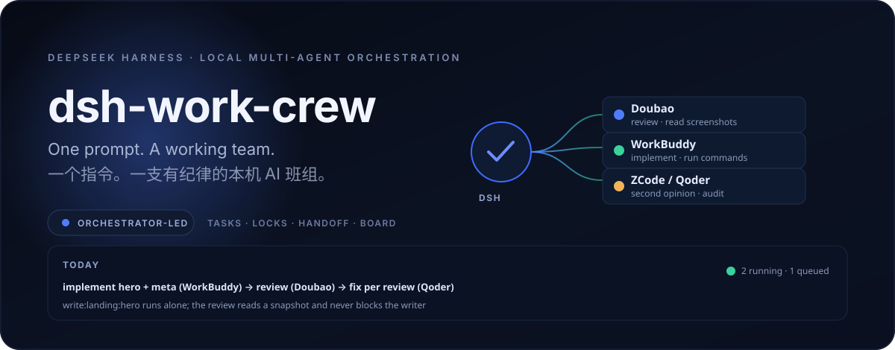

# dsh-work-crew



<p align="center">
  <a href="https://github.com/yxyusage/dsh-work-crew"></a>
  <a href="./LICENSE"></a>
  
  
</p>

<p align="center"><b>One prompt. A working team.</b><br>一个指令。一支有纪律的本机 AI 班组。</p>

<p align="center"><a href="./README.zh-CN.md">简体中文</a> · English</p>

---

`dsh-work-crew` is a [DeepSeek Harness](https://github.com/deepseek-ai/deepseek-harness) plugin that turns the AI apps already
installed on your machine — Doubao, WorkBuddy, ZCode, Qoder — into a **crew with a task board**.

DSH stays the orchestrator. It does not write your code itself; it plans, dispatches, enforces locks,
collects receipts and keeps the books. The crew does the typing.

## Why

One model reviewing its own work is the weakest link in every AI coding session:

| Failure | What the crew does instead |
|---|---|
| **Self-review blind spot** — the model checks its own output | A different model reviews it; the implementer never signs off on itself |
| **Concurrent edits** — writing and reviewing the same file at once | Artifact locks: `write:landing:hero` and `read:landing` cannot overlap in time |
| **Lost progress** — who is waiting for whom, asked again next session | A task board on disk (`.dsh-team/`) with dependencies, locks and timeline |

## Install

```powershell
# from GitHub
dsh plugin --profile desktop add github:yxyusage/dsh-work-crew

# from a local checkout
dsh plugin --profile desktop add "E:\path\to\dsh-work-crew"
```

Then fully quit DSH (tray → Quit) and reopen it.

## Quick start

```text
team_init          → create .dsh-team/ (mission, roles, board, outbox)
team_add_task      → title, worker, dependsOn, write/read locks, expect
team_dispatch      → builds a brief, enforces locks, sends it (queues when busy)
team_collect       → wait for receipts; takes taskIds, returns whoever finishes first
team_status        → board: who is running, what is queued, which locks are held
```

A typical plan:

```
T1  implement hero      WorkBuddy   write:landing:hero
T2  review landing      Doubao      read:landing        ← waits for T1 (write×read)
T3  product discussion  Doubao      —                   ← runs in parallel with T1
T4  docs                Qoder       write:docs          dependsOn: [T1, T2]
```

## Tools

| Tool | When to use |
|---|---|
| `team_init` | first time in a project; records reference dirs and required docs |
| `team_status` | who runs what, queue depth, last activity, held locks |
| `team_add_task` | declare worker, dependencies, locks, deadline, expected artifacts |
| `team_dispatch` | send a brief; **takes `taskIds` to dispatch several in one step**; queues when a worker is busy |
| `team_collect` | wait for receipts: `taskIds` returns whoever finishes first |
| `team_reassign` | move a task to another worker, keeping brief and history |
| `team_reopen` | a false completion → back to running, without re-sending |
| `team_resubmit` | artifacts now exist → re-check expect instead of re-dispatching |
| `team_release` | close a task (refuses `done` while expected artifacts are missing) |
| `team_split_html` | split a single-file page into html/css/js so three workers can edit in parallel |
| `team_shot` | screenshot to a file, path only — device emulation for mobile widths |
| `team_workers` | status / preflight / restart / ping |

## Workers

| id | App | Good at | Debug port |
|---|---|---|---|
| `workbuddy` | WorkBuddy | implementing, running commands, verifying builds | 9332 |
| `doubao` | Doubao | visual review, ideas, reading screenshots | 9331 |
| `zcode` | ZCode | implementation / second opinion (limited free quota) | 9334 |
| `qoder` | Qoder | implementation / read-only audits (VS Code family) | 9335 |

## How it works

- **Driven over CDP.** The plugin launches each app with `--remote-debugging-port` and types into its chat box.
  Windows can stay offscreen; nothing steals your mouse.
- **Completion is a hard signal.** WorkBuddy's "已完成" badge; Doubao/ZCode/Qoder's `@@END@@` sentinel.
  No guessing from text stillness.
- **File handoff.** Workers write reports to `.dsh-team/outbox/<id>.md` and reply with one line.
  The body never enters the orchestrator's context — that is where the token savings come from.
- **Locks with hierarchy.** `landing` covers `landing:hero`; siblings (`hero`, `meta`) run in parallel.
- **Queue, not stuck.** A busy worker queues the task (`queued`, no locks, no timeout) and promotes it when the
  current one is collected.
- **Budget.** `deadlineMin` (default 45) flags a stalled task; at twice the budget it is blocked and its locks released.
- **Artifacts are checked.** `expect` paths must exist before a task counts as done; the outbox file is added automatically.

## Screenshots: two traps that produce false reviews

Use `team_shot` — it already avoids both traps and returns only a path:

```text
team_shot { "target": "index.html", "out": "shots/mobile-390.png", "width": 390, "mobile": true }
```

**Trap 1 — capturing mid-animation.** A headless shot without a virtual clock lands on the fade-in, so the page looks
half-transparent. `team_shot` emulates `prefers-reduced-motion: reduce` and waits for the layout to settle.

**Trap 2 — resizing the window instead of emulating the device.** `--window-size=390,844` sets the *window*, but the
layout keeps the desktop viewport (~980px), so the shot is a cropped desktop page. That reads as "the layout overflows"
and sends a reviewer chasing a bug that does not exist. Device emulation is the only honest mobile shot, and
`team_shot` checks `scrollWidth` for you: if it equals the viewport, the layout is fine.

## Guardrails

Six checks stand between "the model says it is done" and "the task is done":

| Guard | What it does |
|---|---|
| `review: true` | The reviewer gets **requirement + `git diff` + rubric only**. It is told not to read the implementer's report — a reviewer that inherits the author's narrative inherits the author's blind spots. |
| Snapshot review | The changed files are copied to `.dsh-team/snapshots/<id>/` and the reviewer reads **the copy**, so the review takes no read lock and the next implementation starts immediately. Diffing starts from the implementer's recorded `baseCommit`, so committed work still shows up. |
| `verify: "pnpm build"` | The acceptance command runs in the project before the task may close. A red build blocks the task; no green build, no done. |
| `risk: "high"` | High-risk work (auth, payments, CI, secrets, installers) **never self-approves**: collecting it only reports "awaiting approval" until a human re-collects with `confirm: true`. |
| `rubric.md` + review round counter | `team_init` writes the project's acceptance rubric; every review carries it. From the 4th review of the same artifact, the brief asks whether the *plan* is wrong instead of requesting another patch list. |
| `crossCheck: true` | After a review, a **second reviewer** gets the findings and votes on each one: holds / false positive / not enough evidence. Only confirmed issues survive. |

## Knowledge base

"Make it look good" produces nothing. "Look at this, apply it like so, ship when these three rules hold" changes the output.

`team_knowledge` ships curated references; the matching ones are injected into the brief automatically — authors do not have to remember to ask.

| Entry | What it enforces | Source |
|---|---|---|
| `de-ai-slop` | no purple gradients, no three-card hero, no emoji icons, real content instead of filler | [anti-slop checklist](https://github.com/infometa/workbuddyskills/blob/main/experts/design-engine/skills/quality-review/references/anti-slop-checklist.md) |
| `frontend-ui` | component structure and the four states (default/hover/focus/disabled) | [shadcn AI Elements](https://ui.shadcn.com/docs/ai-elements) |
| `motion` | shared-element transitions, 120–360 ms, transform/opacity only, reduced-motion fallback | [smooth-option-switcher](https://github.com/zhoulinhua0-star/smooth-option-switcher) |
| `empty-states` | why it is empty, what to do now, what you will get | [Carbon patterns](https://www.carbondesignsystem.com/building-blocks/core/patterns/empty-states) |
| `typography-color` | modular scale, 16–18px body, 4.5:1 contrast, no pure black | [type-scale](https://type-scale.com) |
| `copywriting` | verbs on buttons, examples instead of adjectives, no judgement | [NN/g microcopy](https://www.nngroup.com/articles/microcopy/) |
| `a11y` | keyboard path, visible focus, button semantics | [web.dev a11y](https://web.dev/learn/accessibility) |

Beyond the interface, the same mechanism covers backend and review work:

| Entry | What it enforces | Source |
|---|---|---|
| `api-design` | plural resources, RFC 9457 errors, idempotent writes | [Google AIP](https://google.aip.dev/) |
| `backend-patterns` | 12-factor, when splitting a service is justified | [microservices.io](https://microservices.io/patterns/index.html) |
| `sql-data` | index by query, read the plan before touching indexes | [use-the-index-luke](https://use-the-index-luke.com/) |
| `testing` | test pyramid, regression test per bug | [Fowler](https://martinfowler.com/articles/practical-test-pyramid.html) |
| `code-review` | five things to look at, two grades of comment | [Google eng-practices](https://google.github.io/eng-practices/review/) |
| `security` | server-side validation, auth at every entry, secrets out of logs | [OWASP Top 10](https://owasp.org/www-project-top-ten/) |
| `observability` | structured logs, metrics, actionable alerts | [OpenTelemetry](https://opentelemetry.io/docs/) |
| `technical-writing` | one page, one purpose (tutorial/how-to/reference/explanation) | [Diátaxis](https://diataxis.fr/) |
| `web-performance` | measure first: LCP/INP/CLS | [HPBN](https://hpbn.co/) |

Matching: explicit `tags` on the task win; otherwise keywords in the title and brief decide. **The worker matters too** —
Doubao is held to design/motion, Qoder to security/structure, ZCode to copy/docs, WorkBuddy to implementation. At most 4
entries, each rendered as link + how to use + what not to do + 3 rules.

And the loop closes at review time: a review task receives **the checklist the implementer was given**, up to 8 rules,
each to be judged `done / not done (with location) / not applicable`. That turns "check it" into findings you can act on.

Project-specific entries go in `.dsh-team/knowledge/<id>.md` and override built-ins by id:

```text
team_knowledge { "action": "add", "id": "brand-guide", "title": "品牌规范", "tags": ["frontend","color"],
  "url": "https://...", "use": "配色只从这 5 个色里选", "avoid": "自创渐变",
  "rules": ["主色 #1f6feb，只用于主按钮", "正文色 #0f1115 / #e6e8eb"] }
```

## Requirements

- Windows with DSH Desktop (or DSH Web + Node 22+).
- At least one of the four apps installed and **logged in**.
- In each app: select the project folder as its workspace, and allow auto-approval / full access.
- The plugin launches the apps itself; an app already running without a debug port must be restarted
  (`team_workers {"action":"restart","worker":"doubao"}`), which is also the fix when a port goes stale.

## Limits

- Selectors are tied to each app's UI. App updates can break them; every worker carries a `spec` version and
  `team_workers {"action":"ping"}` tells you whether the chain still works.
- Quota cannot be read from any of the four apps. A worker that runs out mid-task is detected by timeout and
  is meant to be re-dispatched with `team_reassign`.
- One app can hold only one in-flight task. That is a property of a single input channel, not a bug.
- Kimi desktop is not supported: it rejects both `--remote-debugging-port` and `--remote-debugging-pipe`.

## Layout

```
index.js            tools + the /dsh-work-crew/state route for the panel
lib/team.js         board, locks, briefs, roles, queue
lib/cdp.js          CDP sessions, launch, typing, reading, completion rules
client.js           sidebar panel (React, conversation.composer.dock)
locale/             zh + en metadata
```

## License

MIT
